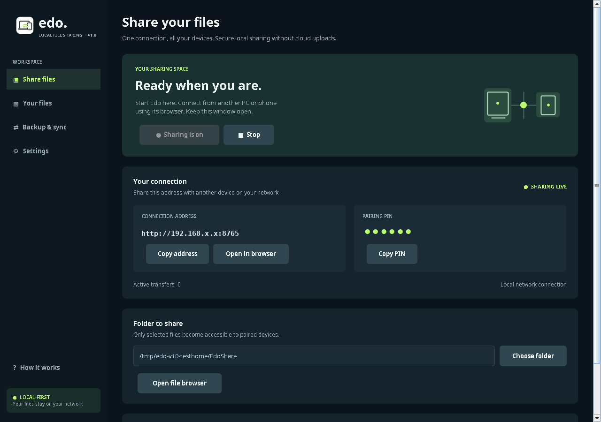

# Edo v1.0 — Every Device. One Connection.

**Free, open-source file sharing across your local network.** Host files on a computer or Google TV and use a browser on another device. No account or cloud relay.

[Downloads](https://github.com/Subaru771/EDO/releases) · [PC-to-PC guide](docs/PC-TO-PC.md) · [Security](SECURITY.md) · [Report a bug](https://github.com/Subaru771/EDO/issues)

## Choose your connection

| Share between | Run Edo on | Connect from |
| --- | --- | --- |
| **PC ↔ PC** | Windows, macOS or Linux computer | Browser on the second computer |
| **Phone ↔ PC** | Computer | Phone browser |
| **PC ↔ TV** | Google TV / compatible Android TV | Computer browser |
| **Phone ↔ TV** | Google TV / compatible Android TV | Phone browser |

**Edo v1.0** is the unified version name for both the TV application and the desktop companion.

## Download

- **Windows desktop:** [Releases](https://github.com/Subaru771/EDO/releases) — select the Windows ZIP or a tested portable build. The Java ZIP requires **Java 21+**; the experimental portable Edo.exe bundles Java.
- **Google TV / Android TV:** the v1.0 Android code is ready to build, but the **production-signed v1.0 APK is not yet published**. The [previous signed APK remains available as a legacy download](https://github.com/Subaru771/EDO/releases/tag/v5.4.2) until a v1.0 update is signed with the existing key and tested on a real TV.
- **iPhone / Android phone:** use Safari or another compatible browser to connect to an Edo host. No native phone app is included.
- **macOS / Linux:** build/run the Java desktop companion with Java 21+. No platform-specific installer is currently published.

For the current build/test and signing process, read [BUILDING.md](BUILDING.md). Do **not** install a debug APK over an existing signed TV installation without checking signing compatibility.

## PC-to-PC setup

1. Extract Edo Desktop on **Computer A**, and open the app (Java 21+ for the Java ZIP).
2. Pick the folder to share and press **Start sharing**.
3. On **Computer B** (same reachable local network), open Computer A's displayed address in your browser.
4. Pair using the displayed PIN or QR link. Approve the device on the host if prompted.
5. Use **Transfer** to upload files to A, or **Files** to download from A. The host can manage files in **Your files**.

[Step-by-step PC-to-PC guide](docs/PC-TO-PC.md) · [Other devices](docs/SHARING-GUIDE.md)

## Desktop screenshots

Actual Edo Desktop captures with private connection details removed:

| Share | Your files |
| --- | --- |
|  |  |

Actual Android TV screenshots are still needed. These desktop captures should not be mistaken for TV screenshots.

## Features

- File upload and download through a local browser
- Native shared-folder browser on Desktop (search, import, rename, move, delete)
- PIN pairing, remembered sessions and optional host approval
- Transfer progress, resumable uploads and file previews
- Optional HTTPS and WebDAV (local certificate trust may require manual setup)
- Desktop backups and safe, non-destructive folder synchronization
- QR/manual address connections and local discovery

Some advanced features vary by device; universal compatibility has not been verified.

## Network and security

Edo is intended for **trusted private LANs**. **HTTP is not encrypted.** Do not expose port 8765 to the public internet. A QR code may include pairing credentials; protect the TV screen and enable approval for new devices where appropriate. Optional HTTPS uses self-signed certificates that some browsers reject.

[Security policy](SECURITY.md) · [Secure connection guide](docs/SECURE-CONNECTION-GUIDE.md) · [Current security review](docs/SECURITY-REVIEW.md)

## Development

- [Build and signing](BUILDING.md)
- [Release policy](docs/RELEASES.md)
- [Changelog](CHANGELOG.md)
- [Contributing](CONTRIBUTING.md)
- [MIT License](LICENSE)

**Android package ID:** `com.dropwave.tv` is intentionally retained for upgrade and data compatibility. The v1.0 Android **version code is 57**, higher than the prior public build even though its visible version name is reset.

*Edo — Every Device. One Connection.*
