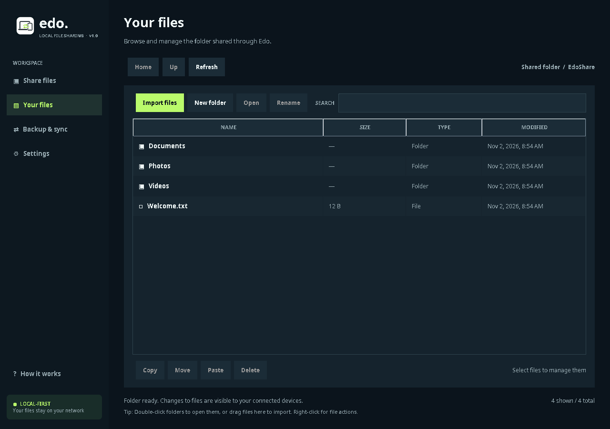

# Edo v1.0 — Every Device. One Connection.

**Free and open-source local file sharing for PCs, phones, and Google TV.** No cloud account. One device hosts files; other devices connect through a browser.

[**Download v1.0**](https://github.com/Subaru771/EDO/releases/tag/v1.0) · [Get started](#quick-start) · [Report a bug](https://github.com/Subaru771/EDO/issues/new/choose) · [Security](SECURITY.md)

## Downloads

| Platform | Download | Setup |
| --- | --- | --- |
| **Google TV / Android TV** | [Edo v1.0 — signed APK](https://github.com/Subaru771/EDO/releases/tag/v1.0) | Install the Android APK on a compatible TV |
| **Windows 10/11** | [Edo Desktop v1.0 — portable](https://github.com/Subaru771/EDO/releases/tag/v1.0) | Extract the ZIP; run `Edo/Edo.exe` — **Java included** |
| **iPhone / Android phone** | No app needed | Connect through the host's local address in Safari or Chrome |
| **macOS / Linux** | Java desktop source | Build and run with Java 21+; native installer not provided |

The Windows portable build bundles Java and was tested on a Windows PC. Executables are currently **unsigned**, so Windows SmartScreen may display a warning; do not disable security software to install. Download checksums from the same [release](https://github.com/Subaru771/EDO/releases/tag/v1.0).

### What Edo can connect

| Transfer | Host device | Other device |
| --- | --- | --- |
| PC ↔ PC | Edo Desktop on one computer | Browser on the second PC |
| Phone ↔ PC | Edo Desktop on a computer | Browser on the phone |
| PC ↔ TV | Edo on Google TV | Browser on a computer |
| Phone ↔ TV | Edo on Google TV | Browser on the phone |

Both devices must be on the same reachable, trusted local network. The host must stay awake and keep Edo running.

## Quick start

1. Install and open Edo on your **Windows PC or Google TV**.
2. Choose a folder (on the desktop host) and select **Start sharing**.
3. On your other device, open the **local URL** shown by Edo or scan the QR code.
4. Pair using the PIN and approve the connection on the host when prompted.
5. Open **Transfer** to upload, or **Files** to download. On Edo Desktop, use **Your files** to manage the shared folder.

[Detailed PC-to-PC guide](docs/PC-TO-PC.md) · [Sharing guide](docs/SHARING-GUIDE.md)

## Features

- LAN upload and download through any compatible modern browser
- Native **Your files** manager on Windows: browse, search, import, rename, move and delete
- QR/PIN pairing, remembered devices and optional host approval
- Transfer progress, file previews, ZIP export, and supported resumable transfers
- Optional HTTPS and authenticated WebDAV (self-signed certificate limitations apply)
- Desktop backup and non-destructive folder synchronization
- Google TV interface designed for the remote control

Availability varies by platform and browser.

## Desktop screenshots

Actual v1.0 desktop captures with pairing information removed:

| Share | Your files |
| --- | --- |
|  |  |

Actual TV screenshots can be added after capturing them on a device.

## Safety and privacy

**Edo is for trusted home/local networks, not internet exposure.** HTTP is **not encrypted**. Never forward Edo's ports to the public internet. A QR link can contain pairing credentials, so treat it as a password; approval for new TV devices is enabled by default on fresh installations. Optional HTTPS uses locally generated certificates that may require manual trust.

[Security details](SECURITY.md) · [HTTPS instructions](docs/SECURE-CONNECTION-GUIDE.md)

## Building and contributing

[Build instructions](BUILDING.md) · [Changelog](CHANGELOG.md) · [Contributing](CONTRIBUTING.md) · [MIT License](LICENSE) · [Release policy](docs/RELEASES.md)

Both applications are **Edo v1.0**. For Android updates, the original package ID `com.dropwave.tv` is retained and Android version code is **57** to preserve upgrade order.

**Edo — Every Device. One Connection.**
