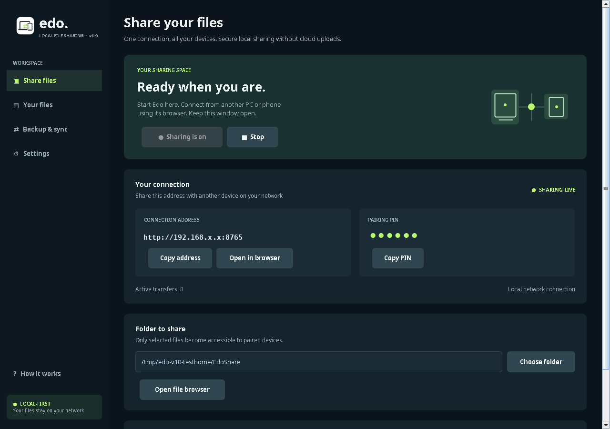
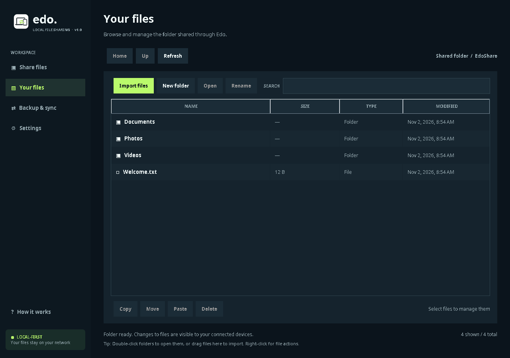

# Edo screenshots

These are genuine captures of **Edo Desktop v1.0** running in a test environment, with private connection information masked. They are **not** photographs or captures of the public Android TV release.

## Share files

The host displays its local address and pairing PIN, plus controls for starting sharing and choosing the shared folder.

## Your files

Native file management for the chosen shared folder: search, import, create folders, open, rename, copy, move, and delete.

## Additional screenshots to capture

The **Backup & Sync**, **Settings**, actual Google TV home screen, and browser client still need sanitized screenshots from running builds. Do not describe these screenshots as tested on physical devices unless that testing has occurred.

Before publishing screenshots, conceal live IP addresses, pairing PINs and QR credentials, usernames, private folder paths, personal files, and other identifiers.

[Return to README](../README.md#desktop-screenshots)
